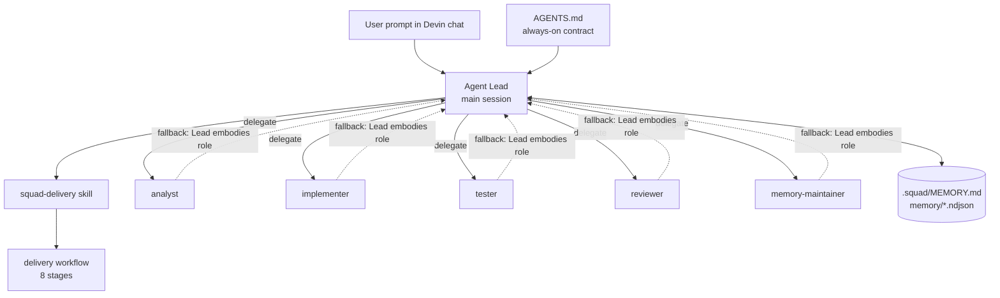
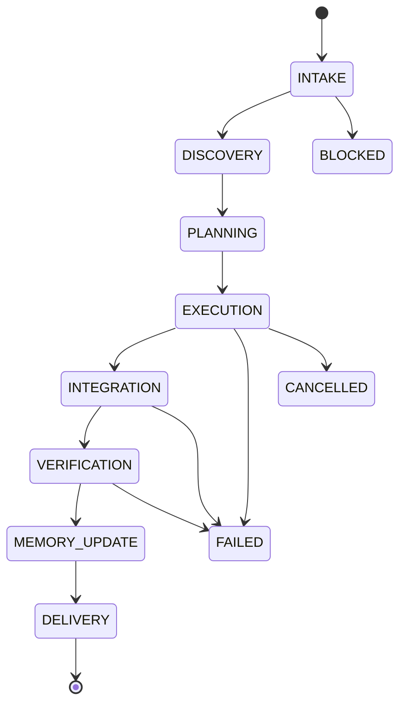

# XQ Squad

Repository-native Devin subagent squad. Install into any GitHub repository and operate through Devin chat.

## What it is

- One Agent Lead in the main Devin session.
- Specialist subagent profiles: analyst, implementer, tester, reviewer, memory-maintainer.
- Delivery skill and workflows.
- Durable shared memory in the repository: Markdown knowledge, NDJSON records, JSON schemas.
- Versioned GitHub Releases with installer, archive, and checksum.
- No hosted service, database, GitHub App, or custom runtime.

## How it works



Delivery lifecycle:



## Repository layout

```text
xq-squad/
├── distribution/          # Consumer-ready files
│   ├── AGENTS.md
│   ├── .devin/
│   └── .squad/
├── install.sh           # Consumer installer
├── update.sh            # Consumer upgrader
├── scripts/             # Source tooling and validators
├── tests/               # Automated tests
├── README.md
├── CHANGELOG.md
└── CONTRIBUTING.md
```

## Quick start for consumers

Pipe the installer straight into `sh` (POSIX-compatible, no download needed):

```bash
curl -LsSf https://github.com/ExperienceQuality/xq-squad/releases/download/v1.0.4/install.sh | sh -s -- --target . --version v1.0.4
```

The installer is self-contained: helper scripts ship inside the release archive.
If the target repo has uncommitted changes and stdin is not a TTY (e.g. piped or
CI), the installer refuses to continue — pass `--yes` to proceed non-interactively:

```bash
curl -LsSf https://github.com/ExperienceQuality/xq-squad/releases/download/v1.0.4/install.sh | sh -s -- --target . --version v1.0.4 --yes
```

Or download and run it yourself:

```bash
curl -fL https://github.com/ExperienceQuality/xq-squad/releases/download/v1.0.4/install.sh -o /tmp/squad-install.sh
sh /tmp/squad-install.sh --target . --version v1.0.4
```

Or use a local archive:

```bash
bash install.sh --target . --version v1.0.4 --archive squad-v1.0.4.tar.gz --checksum squad-v1.0.4.tar.gz.sha256
```

## Using the squad

After installing, there is nothing to configure — open a Devin session on the
consumer repository and describe your task in chat. The installed `AGENTS.md`
makes Devin the **Agent Lead** automatically; no slash commands or special
syntax are needed.

Example prompts:

```text
Add pagination to the /orders endpoint, page size 50.
Fix the flaky checkout test and tell me what was wrong.
Refactor the auth middleware to use the new token service.
```

What happens on each request:

1. **Intake & discovery** — the Lead establishes acceptance criteria, reads
   `.squad/README.md` and relevant memory, and maps affected files
   (delegating to the `analyst` profile when subagents are available).
2. **Planning & execution** — tasks are planned and delegated to specialist
   profiles (`implementer`, `tester`) or performed directly by the Lead.
3. **Verification** — the relevant build/test/lint checks run; only observed
   results are reported.
4. **Memory update** — durable findings are written to `.squad/MEMORY.md` and
   `.squad/memory/` by the `memory-maintainer` profile (reports `UPDATED`,
   `UNCHANGED`, or `BLOCKED`).
5. **Delivery** — you get a report of what changed, which checks ran, review
   findings, and memory status.

**Delegation fallback:** if Devin custom subagents are enabled, specialists
run as delegated subagents using the `.devin/agents/` profiles. If they are
unavailable, the Lead performs each role sequentially — same workflow, same
delivery contract, just slower.

**Memory:** the squad keeps durable knowledge in `.squad/MEMORY.md` plus
NDJSON records under `.squad/memory/`. Only relevant records are loaded per
task (see `.squad/scripts/memory-search.mjs`). You can seed repository
knowledge in `.squad/knowledge/` — it is consumer-owned and never overwritten
by upgrades.

**Authority:** the Lead never commits, pushes, or opens a PR unless you
explicitly ask it to in the session.

## Updating

Pull a newer release into a consumer repo (`install.sh` refuses to run over an
existing installation — always use `update.sh` for upgrades):

```bash
curl -LsSf https://github.com/ExperienceQuality/xq-squad/releases/download/v1.0.4/update.sh | sh -s -- --target . --version v1.0.4
```

Or, from a clone of this repo:

```bash
bash update.sh --target /path/to/consumer-repo --version v1.0.4
```

`update.sh` requires Node.js ≥ 20 (it runs the three-way merge helper shipped
inside the release archive).

Upgrades only touch squad-managed files (see the `ownership` section of
`.squad/squad.json`). Consumer edits to managed files are detected and
preserved; consumer-owned paths (`.squad/MEMORY.md`, `.squad/knowledge/`,
`.squad/memory/`, `.devin/rules/local-*`, `.devin/agents/local-*`) are never
touched.

## Development

Validate the distribution:

```bash
bash scripts/validate.sh
```

Package a release:

```bash
bash scripts/package-release.sh --version v1.0.4
```

Run tests:

```bash
node --test tests/*.test.mjs
bash tests/install.test.sh
bash tests/install-pipe.test.sh
bash tests/upgrade.test.sh
bash tests/e2e.test.sh
```

## Release process

1. Bump `version` and `release_tag` in `distribution/.squad/squad.json`.
2. Update `CHANGELOG.md`.
3. Merge to `main` — the `release` workflow validates, runs the full test
   suite, tags the commit, and publishes `install.sh`, the archive, and the
   checksum as release assets automatically.
4. Or trigger manually via `workflow_dispatch` with an optional `version`
   input (e.g. `v1.0.4`).

If the tag or release already exists, the workflow skips publishing.
