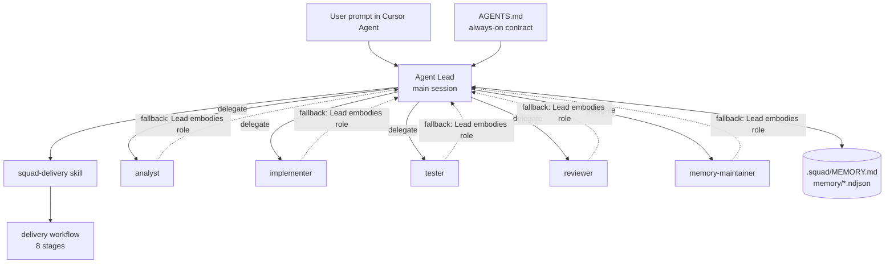
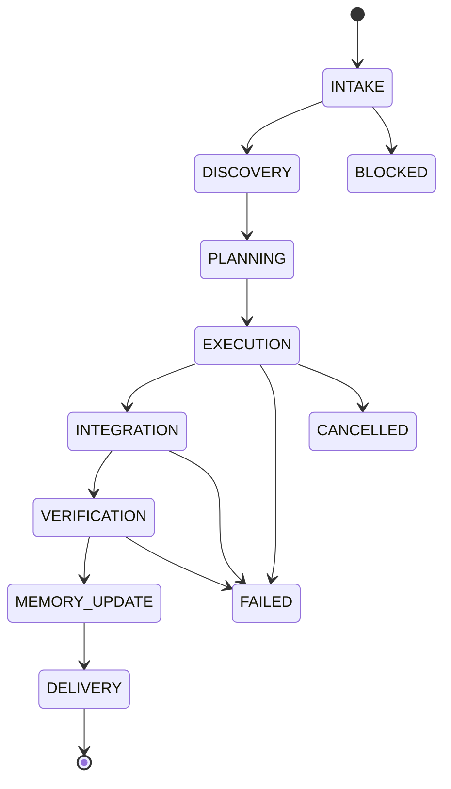

# XQ Squad

Install a versioned agent squad into a GitHub repository so the Cursor Agent runs your software tasks through one repeatable, verified delivery process.

Current release: **v2.0.0** — see [CHANGELOG.md](CHANGELOG.md) and
[GitHub Releases](https://github.com/ExperienceQuality/xq-squad/releases).

## What it is and who it's for

XQ Squad is an installable bundle of Markdown contracts, runtime adapters,
JSON schemas, and Node.js helper scripts. Installing it into a repository
makes the main agent session (the Cursor Agent) an
**Agent Lead** that runs an 8-step delivery process and delegates to
specialist roles.

- For teams that use Cursor on a repository and want every task
  delivered the same way: acceptance criteria, observed checks, review, and a
  memory update.
- `.squad/` is the canonical, runtime-independent core. `.cursor/` is a
  thin adapter over it (see
  [`docs/architecture.md`](docs/architecture.md)).
- Project memory lives in the repository itself: `.squad/MEMORY.md` plus NDJSON
  records under `.squad/memory/`, validated by a JSON schema.
- No hosted service, server, database, GitHub App, or custom runtime. The
  interface is Cursor Agent chat.
- Versioned GitHub Releases ship the installer, the updater, an archive, and
  a SHA-256 checksum.

## How it works



Delivery lifecycle:



In Cursor, the always-on rule `.cursor/rules/xq-squad.mdc` plays the role of
`AGENTS.md`, and the specialists run as Cursor subagents.

### Roles

| Role | Runs as | Responsibility | Cursor subagent |
| --- | --- | --- | --- |
| Agent Lead | The main agent session (never a subagent) | Owns the request from intake to delivery; plans, delegates, integrates, reports | — |
| `analyst` | Subagent, or the Lead | Repository discovery and impact analysis | `readonly: true` |
| `implementer` | Subagent, or the Lead | Assigned code changes following repository conventions | `readonly: false` |
| `tester` | Subagent, or the Lead | Runs the relevant checks and tests | `readonly: false` |
| `reviewer` | Subagent, or the Lead | Reviews changes and identifies risks | `readonly: true` |
| `memory-maintainer` | Subagent, or the Lead | Reconciles durable memory; reports `UPDATED`, `UNCHANGED`, or `BLOCKED` | `readonly: false` |

Role contracts live in `.squad/agents/<role>.md`. The Cursor subagents
(`.cursor/agents/<role>.md`) point to them. If custom subagents are unavailable, the Lead performs each
role itself, sequentially.

### Authority rule

The Lead never commits, pushes, or opens a PR unless you explicitly authorize
it in the session. Before any authorized push or PR, it fetches the configured
remote and rebases the working branch onto the current remote target branch,
resolves conflicts, and reruns verification. If the rebase cannot complete,
it reports `BLOCKED` and does not push or open a PR.

In Cursor, the `xq-squad-git-guard` hook also asks you to approve each
`git commit`, `git push`, `gh pr create`, and `gh release create`.

## Requirements

| Activity | Requirements |
| --- | --- |
| Install (`install.sh`) | POSIX `sh`, `git`, `curl`, `tar`, and one SHA-256 tool (`shasum`, `sha256sum`, or `openssl`). The target must be a Git repository without an existing `.squad/` directory. Node.js 22 or newer is optional: without it, POSIX fallbacks handle the `AGENTS.md` merge and install state, but `.cursor/hooks.json` is not written or merged, so the Cursor hooks are **not installed** and their guardrails are unenforced (the installer warns). Install Node 22+ and rerun `update.sh` to add them. |
| Upgrade (`update.sh`) | Everything install needs, plus Node.js 22 or newer (runs `.squad/scripts/upgrade-managed.mjs` from the new release); `update.sh` refuses to start with an older Node or none. The target must have `.squad/install-state.json`. |
| Concurrent delivery (opt-in) | Node.js 22 or newer; Git with worktree support (the helpers run `git worktree list --porcelain -z`, which needs Git 2.36 or later); a local filesystem; a base commit that already contains compatible installed `.squad` helpers. |
| Runtime | The Cursor Agent on the repository. Cursor hooks need Node.js 22 or newer on `PATH`. Without subagents, the Lead runs each role itself. Node.js runs the `.squad/scripts/*.mjs` helpers (memory search/update, `fetch-openapi-spec`). |

## Install

Pipe the installer straight into `sh` (POSIX-compatible, no download needed):

```bash
curl -LsSf https://github.com/ExperienceQuality/xq-squad/releases/download/v2.0.0/install.sh | sh -s -- --target . --version v2.0.0
```

The installer is self-contained: helper scripts ship inside the release archive.
If the target repo has uncommitted changes and stdin is not a TTY (e.g. piped or
CI), the installer refuses to continue — pass `--yes` to proceed non-interactively:

```bash
curl -LsSf https://github.com/ExperienceQuality/xq-squad/releases/download/v2.0.0/install.sh | sh -s -- --target . --version v2.0.0 --yes
```

Or download and run it yourself:

```bash
curl -fL https://github.com/ExperienceQuality/xq-squad/releases/download/v2.0.0/install.sh -o /tmp/squad-install.sh
sh /tmp/squad-install.sh --target . --version v2.0.0
```

Or use a local archive:

```bash
bash install.sh --target . --version v2.0.0 --archive squad-v2.0.0.tar.gz --checksum squad-v2.0.0.tar.gz.sha256
```

### `install.sh` flags

| Flag | Required | Meaning |
| --- | --- | --- |
| `--target PATH` | Yes | Repository to install into. Must contain a `.git` directory. |
| `--version vX.Y.Z` | Yes | Release tag to install. Must match `vX.Y.Z`. |
| `--repo OWNER/REPO` | No | GitHub repository to download release assets from. Default: `ExperienceQuality/xq-squad`. |
| `--archive PATH` | No | Use a local release archive instead of downloading. Takes effect only together with `--checksum`. |
| `--checksum PATH` | No | Local `.sha256` file for `--archive`. |
| `--dry-run` | No | Run preflight checks, download, verify the checksum, and check the archive contents, then exit without writing anything to the target. |
| `--yes` | No | Continue without a prompt when uncommitted changes overlap squad-managed paths. |
| `-h`, `--help` | No | Print usage. |

About the `--yes` warning: the installer checks tracked files with uncommitted
changes (untracked files are ignored). Changes outside the squad-managed paths
only print a note. Changes under **`AGENTS.md`**, **`.squad/`**,
or **`.cursor/`** (and, for `update.sh`, **`.devin/`** from a 1.x install) print a warning listing those files, then ask for
confirmation on a TTY, fail without a TTY, or continue with `--yes`.

Existing adapter files are not overwritten. If a file under
`.cursor/` already exists with different content, the installer keeps it,
writes the release copy next to it as `<file>.squad-upstream`, leaves it
consumer-owned, and lists it at the end. An existing `.cursor/hooks.json` is
merged instead (with Node.js 22 or newer; otherwise it is left untouched and
the squad hooks are not installed).

`install.sh` refuses to run over an existing installation (an existing
`.squad/` directory). Always use `update.sh` to upgrade.

## Upgrade

Pull a newer release into a consumer repo:

```bash
curl -LsSf https://github.com/ExperienceQuality/xq-squad/releases/download/v2.0.0/update.sh | sh -s -- --target . --version v2.0.0
```

Or, from a clone of this repo:

```bash
bash update.sh --target /path/to/consumer-repo --version v2.0.0
```

`update.sh` accepts the same flags as `install.sh` except `--dry-run`. It
exits early if the installed version already matches `--version`, refuses to
move to a lower version, and applies the same uncommitted-change check (and
`--yes`) as the installer. Extra flags:

| Flag | Description |
| --- | --- |
| `--remove-retired` | Delete unmodified retired files (files the new release no longer ships). At the installed version, runs only this cleanup. |
| `--keep-retired` | Keep unmodified retired files without asking. |
| `--allow-downgrade` | Allow `--version` lower than the installed version. |

Without `--remove-retired` or `--keep-retired`, `--yes` also deletes unmodified
retired files; otherwise `update.sh` asks on the terminal, and keeps them when
there is no terminal.

### What an upgrade touches

`.squad/squad.json` declares three ownership classes, and
`.squad/install-state.json` records a SHA-256 baseline for every managed file.

- **Managed files** (`.cursor/agents/`, `.cursor/skills/`, `.cursor/rules/xq-squad*.mdc`,
  `.cursor/hooks/xq-squad-*`, `.squad/agents/`, `.squad/workflows/`,
  `.squad/schemas/`, `.squad/scripts/`, `.squad/README.md`):
  - unchanged by you → replaced with the new release's version;
  - changed by you, unchanged upstream → your version is kept;
  - changed by you and upstream → your file is kept, the new version is
    written next to it as `<file>.squad-upstream`, and the conflict is
    reported. The baseline is not advanced, so the next update checks it
    again. Merge the two by hand and delete the sidecar.
- **Merge-managed files**: `AGENTS.md` (see the markers below),
  `.cursor/hooks.json` (entries whose command is under
  `.cursor/hooks/xq-squad-*` are replaced; your hooks are kept),
  `.squad/squad.json`, and `.squad/install-state.json`.
- **New files** first shipped by a newer release are installed and registered
  in `install-state.json`. If a different file of yours already sits at that
  path, it is kept, the release copy goes to `<file>.squad-upstream`, and the
  conflict is reported.
- **Consumer-owned files** (`.squad/MEMORY.md`, `.squad/knowledge/`,
  `.squad/memory/`, and `local-*` files under `.cursor/agents/`, `.cursor/rules/`, `.cursor/skills/`,
  and `.cursor/hooks/`) are yours. Releases ship nothing under
  `.squad/knowledge/`, `.squad/memory/`, or the `local-*` paths, so upgrades
  never write there. `.squad/MEMORY.md` is installed once as a starter
  template.

- **Retired files** were shipped by an earlier release and are no longer
  shipped (listed with a reason in `.squad/retired.json`). They are never a
  conflict and leave `managed_files`. Unmodified ones are deleted only with
  consent (`--remove-retired`, `--yes`, or "y" at the prompt); otherwise they
  are kept and recorded under `retired_files` in `install-state.json`. Files
  you changed are kept and reported; delete them by hand.

When conflicts are reported, `update.sh` lists them and exits non-zero.
Each upgrade also refreshes the `ownership` in `install-state.json` from the
new release's `squad.json`.

### Upgrading from 1.x

2.0.0 removes the Devin adapter; xq-squad is Cursor-only and needs Node.js 22 or newer.
Run the normal update command with the 2.0 release. The updater lists the `.devin/` files it no longer ships:

- unmodified files are deleted only if you pass `--yes` or `--remove-retired`, or answer "y";
- files you changed are kept and reported, and the update still succeeds;
- your `.devin/rules/local-*` and `.devin/agents/local-*` files are never touched.

If you kept the files, delete them later with `update.sh --target . --remove-retired`.
If you still use Devin, stay on 1.x.

### Rollback

Squad files are committed in your repository, so the simplest rollback is
`git revert`/`git checkout` of the upgrade commit. Without one: delete the
`.cursor/` files listed under `managed_files` in `.squad/install-state.json`
(keep your own), remove the `xq-squad-*` entries from `.cursor/hooks.json`,
then reinstall the previous version into a clean checkout of `.squad/`.
`update.sh --allow-downgrade` also moves to an older release.

### `AGENTS.md` markers

The squad owns only a marked section of the repository's root `AGENTS.md`:

```text
<!-- XQ_SQUAD_MANAGED_START version:vX.Y.Z -->
...
<!-- XQ_SQUAD_MANAGED_END -->
```

Install appends this section to an existing `AGENTS.md` (or creates the
file); upgrades replace only the content between the markers. Text outside
the markers is preserved. Release packaging stamps the start marker with the
release version.

## Usage

After installing, there is nothing to configure — open the consumer
repository in Cursor and describe your task in Agent chat. The installed
`AGENTS.md` and `.cursor/rules/xq-squad.mdc` make the Cursor Agent the
**Agent Lead** automatically; no slash commands or special
syntax are needed.

**Cursor:** open the repository in Cursor and use Agent chat the same way. The
always-on rule `.cursor/rules/xq-squad.mdc` makes the Cursor Agent the Lead,
and the specialists run as Cursor subagents from `.cursor/agents/`. Project
hooks ask before every `git commit`, `git push`, `gh pr create`, and
`gh release create`. They also block writes outside a concurrent delivery's
claimed scope, and send one verification reminder before a dirty delivery
worktree finishes. Details:
[`docs/cursor-integration.md`](docs/cursor-integration.md).

Example prompts:

```text
Add pagination to the /orders endpoint, page size 50.
Fix the flaky checkout test and tell me what was wrong.
Refactor the auth middleware to use the new token service.
```

What happens on each request:

1. **Intake and discovery**: the Lead sets acceptance criteria, reads
   `.squad/README.md` and the relevant memory, and maps the affected files
   (through the `analyst` subagent when subagents are available).
2. **Planning and execution**: tasks are planned and delegated to specialists
   (`implementer`, `tester`) or done directly by the Lead.
3. **Integration and verification**: outputs are reconciled, the full diff is
   inspected, and the relevant build/test/lint checks run. Only observed
   results are reported.
4. **Memory update**: durable findings go to `.squad/MEMORY.md` and
   `.squad/memory/` (the `memory-maintainer` reports `UPDATED`, `UNCHANGED`,
   or `BLOCKED`).
5. **Delivery**: you get a report of what changed, which acceptance criteria
   were met, which checks ran, review findings, memory status, and blockers.

Only relevant memory records are loaded per task
(`.squad/scripts/memory-search.mjs`). Seed repository knowledge in
`.squad/knowledge/`; it is consumer-owned.

## Concurrent delivery

Concurrent delivery shipped in 1.1.0 and is **opt-in**. It lets separate agent
sessions deliver independent work in the same
consumer repository without colliding. Ask the Lead to use
`.squad/workflows/concurrent-delivery.md`; the operating procedure is in
[`distribution/.squad/workflows/concurrent-delivery.md`](distribution/.squad/workflows/concurrent-delivery.md).

- Every delivery runs in its own Git worktree at
  `.squad/worktrees/<delivery-id>` on branch `squad/<delivery-id>`, including
  the first. Each acquisition requires explicit user approval, and the main
  checkout (branch, HEAD, index, dirty files) is never touched.
- Claims live in a shared registry under the repository's common Git
  directory, so the main checkout and linked worktrees see the same claims.
  Inspect them without changing anything:
  `node .squad/scripts/delivery-session.mjs status`.
- Scope conflicts **hard-block**: overlapping path claims fail acquisition
  and there is no override. Stale claims do not auto-expire; they keep
  blocking until released.
- Interrupted sessions are recovered explicitly: `resume` and `release`
  require fresh approval plus a stopped-session confirmation, and release
  preserves the worktree, branch, and dirty/untracked files. Nothing is
  deleted automatically.
- Delivery memory goes to `.squad/memory/deliveries/<delivery-id>.ndjson`;
  reconciling it into shared memory is not automatic.
- In Cursor, open each delivery's worktree as its own workspace so the scope
  guard hook applies.
- Not isolated: shared ports, databases, external services, and manual edits
  outside claimed paths are outside the protocol's scope.

**Validation status:** before 2.0.0, concurrent delivery was validated
end-to-end with two real Devin CLI sessions (archived report:
[`docs/archive/devin-compatibility-report.md`](docs/archive/devin-compatibility-report.md)).
**It is not yet validated in real Cursor sessions**, and subagent delegation
inside a concurrent delivery has not been tested; the Cursor adapter is
verified by automated tests only (see
[`docs/cursor-compatibility-report.md`](docs/cursor-compatibility-report.md)).
Claims coordinate cooperating squad sessions only; they cannot police manual
edits or unrelated tools.

## Included skills and helpers

Skills install to `.cursor/skills/<name>/SKILL.md` and
are registered in `.squad/squad.json` under `components.skills`.

### `squad-delivery`

Runs the 8-stage delivery workflow from `.squad/workflows/delivery.md` for a
build, fix, review, or change request. The agent can invoke it on its own, or
you can ask for it. It has no commands or options of its own.

### `train-me`

A patient tutor for learning any technical topic. Use it when you want to
learn something rather than just get an answer: say "train me", "teach me",
or "help me learn", or share a mistake or error to learn from. It explains
simply, uses analogies and short annotated examples, guides with questions
when you are stuck, and ends with one suggested next step. It always explains
the why, even when asked to "just tell me". It has no commands or options.

### `fetch-openapi-spec`

Syncs OpenAPI contracts from the centralized
[`xq-luthor`](https://github.com/ExperienceQuality/xq-luthor) repository
(`openapi/<service>/openapi.yaml`) into the consumer repository. Use it when
you ask to download, sync, or update an API contract. The skill drives the
helper `.squad/scripts/fetch-openapi-spec.mjs`:

```bash
node .squad/scripts/fetch-openapi-spec.mjs <service>   # one service
node .squad/scripts/fetch-openapi-spec.mjs --all       # every service with an openapi.yaml
node .squad/scripts/fetch-openapi-spec.mjs --list      # list available services
```

| Option | Meaning |
| --- | --- |
| `<service>` | Service directory under `openapi/` in the source repo. Cannot be combined with `--all`. |
| `--all` | Fetch every service that has an `openapi.yaml`. |
| Print available services and exit. |
| `--out <dir>` | Output root, relative to the Git repository root (default `openapi`). Absolute paths and `..` are rejected. |
| `--ref <ref>` | Branch, tag, or SHA in the source repo (default: its default branch). |
| `--repo <owner/repo>` | Source repository. Default `ExperienceQuality/xq-luthor`, or the `XQ_OPENAPI_REPO` environment variable. |
| `-h`, `--help` | Print usage. |

Specs are written to `<out>/<service>/openapi.yaml` under the Git repository
root, regardless of the current working directory. For each spec it writes,
the helper prints the source repository and the resolved commit SHA.

Authentication is tried in this order:

1. The `gh` CLI, if installed: all requests go through `gh api` with its own
   login.
2. Otherwise, a `GH_TOKEN` environment variable.
3. Otherwise, a `GITHUB_TOKEN` environment variable.
4. Otherwise, an unauthenticated request (public repositories only).

On a 401 or 403 the skill tells the agent to stop and ask you for credentials
instead of guessing tokens. If a spec changed, the agent shows the diff and
asks before regenerating clients or changing code that uses the contract.

### Helper scripts

`.squad/scripts/` also ships `memory-search.mjs` and `memory-update.mjs`
(relevant-memory retrieval and schema-validated NDJSON writes), the
concurrent-delivery helpers (`delivery-*.mjs`), and the installer/upgrader
helpers (`merge-agents.mjs`, `merge-cursor-hooks.mjs`,
`write-install-state.mjs`, `upgrade-managed.mjs`).

## What gets installed

Files that land in the consumer repository:

```text
AGENTS.md                         # Managed section with the Agent Lead contract (merged into an existing file)
.cursor/
  rules/xq-squad.mdc              # Always-on Lead rule for the Cursor Agent
  agents/                         # Cursor subagents for the same five roles
  skills/                         # squad-delivery, train-me, fetch-openapi-spec
  hooks.json                      # Merge-managed project hooks
  hooks/xq-squad-*.mjs            # git guard, scope guard, verify reminder (+ shared I/O helper)
.squad/
  README.md                       # In-repo guide the Lead reads during discovery
  squad.json                      # Component catalog, runtimes, and ownership classes
  retired.json                    # Files no longer shipped, with the reason
  install-state.json              # Generated: installed version, managed-file hashes, retired_files
  MEMORY.md                       # Consumer-owned memory summary (starter template)
  agents/                         # Lead and specialist role contracts
  workflows/                      # delivery, memory-maintenance, parallel-execution, concurrent-delivery
  schemas/                        # squad-config, memory-record, delivery-session JSON schemas
  scripts/                        # Node.js helpers
```

Created later, during use: `.squad/knowledge/` and `.squad/memory/`
(consumer-owned), `.squad/worktrees/` for concurrent deliveries, `openapi/`
when you fetch specs, and `<file>.squad-upstream` sidecars when an install or
upgrade keeps one of your files.

## Repository layout

```text
xq-squad/
├── distribution/            # Exactly what ships to consumers (see above)
│   ├── AGENTS.md
│   ├── .cursor/             # Cursor adapter
│   └── .squad/              # Canonical core
├── install.sh               # Consumer installer (POSIX sh)
├── update.sh                # Consumer upgrader (POSIX sh)
├── scripts/                 # validate.sh, validate-squad-config.mjs, validate-cursor-adapter.mjs, package-release.sh
├── tests/                   # Node and shell tests, fixtures
├── docs/                    # Architecture, Cursor integration, compatibility reports, concurrent-delivery spec and notes
├── tasks/                   # Planning notes
├── .github/workflows/       # release.yml
├── README.md
├── CHANGELOG.md
└── CONTRIBUTING.md
```

## Development and testing

Requires Node.js 22 or newer and, for the concurrent-delivery tests, Git 2.36 or
later. There is no `package.json`; run the scripts directly.

Validate the distribution (also runs `scripts/validate-cursor-adapter.mjs`):

```bash
bash scripts/validate.sh
```

Run the tests (the release workflow runs these same commands):

```bash
node --test tests/*.test.mjs
bash tests/install.test.sh
bash tests/install-pipe.test.sh
bash tests/install-minimal.test.sh
bash tests/upgrade.test.sh
bash tests/e2e.test.sh
bash tests/install-cursor.test.sh
bash tests/upgrade-retired.test.sh
bash tests/concurrent-delivery.test.sh
bash tests/node-floor.test.sh
```

`tests/concurrent-delivery.test.sh` is a two-process protocol fixture: it
tests protocol behavior only, not real runtime compatibility.

Package a release locally (writes to `.releases/`):

```bash
bash scripts/package-release.sh --version v2.0.0
```

## Releasing

The `release` workflow ([`.github/workflows/release.yml`](.github/workflows/release.yml))
runs on every push to `main` and on manual `workflow_dispatch` (with an
optional `version` input; it defaults to `release_tag` in
`distribution/.squad/squad.json`).

1. It resolves the version and skips everything if that tag or GitHub
   Release already exists. Merging a change without a version bump publishes
   nothing.
2. Otherwise it runs `scripts/validate.sh` and the test commands above, then
   packages the release.
3. It creates and pushes the annotated tag, creates the GitHub Release with
   generated notes, and uploads `install.sh`, `update.sh`,
   `squad-<version>.tar.gz`, and `squad-<version>.tar.gz.sha256`.

To release, bump `version` and `release_tag` in
`distribution/.squad/squad.json`, update `CHANGELOG.md`, and merge to `main`.
See [CONTRIBUTING.md](CONTRIBUTING.md) for the version rules.

> **Every version bump must update every version pin in this README**:
> release-asset URLs, `--version` flags, archive filenames, and the
> "Current release" line. `scripts/validate.sh` fails if any `vX.Y.Z` string in
> this README differs from `release_tag`, so a stale README blocks the release.
> Write older versions without the `v` prefix (for example "shipped in 1.1.0").

## Contributing and changelog

- [CONTRIBUTING.md](CONTRIBUTING.md): source vs. distribution planes,
  installer portability, adding agents and skills, compatibility classes,
  version bumps, and required checks.
- [CHANGELOG.md](CHANGELOG.md): changes in each release.
