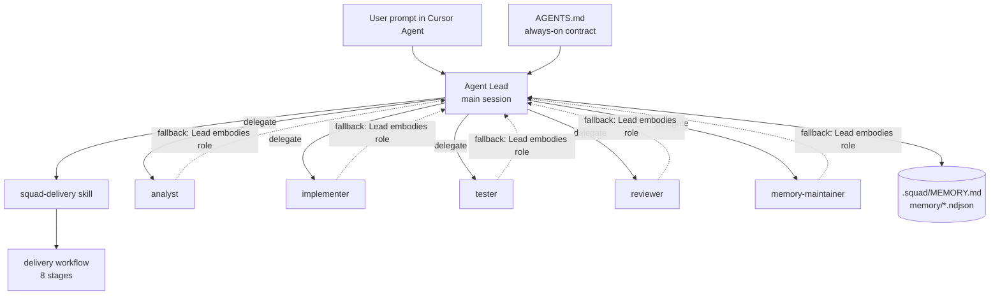
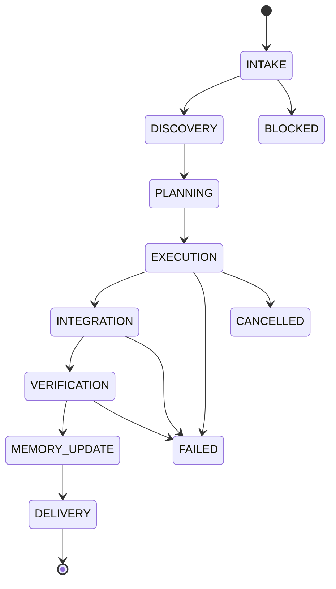

# XQ Squad

Repository-native agent squad for Cursor. No hosted service. No database. The Cursor Agent is the interface. This `.squad/` directory is the canonical, runtime-independent source of truth; `.cursor/` only adapts it to the runtime and must not weaken it.

Installed release: see `release_tag` in `.squad/squad.json` (or `.squad/install-state.json`).
Current upstream release: v2.0.0 — [releases](https://github.com/ExperienceQuality/xq-squad/releases),
[changelog](https://github.com/ExperienceQuality/xq-squad/blob/main/CHANGELOG.md).

## Layout

```text
AGENTS.md                          # Always-on Lead instructions, managed section
.cursor/
  rules/xq-squad.mdc               # Always-on Cursor rule (Lead contract pointer)
  agents/                          # Cursor subagents (point to .squad/agents/)
  skills/squad-delivery/SKILL.md   # On-demand delivery skill
  skills/train-me/SKILL.md         # Tutor skill for learning a topic
  skills/fetch-openapi-spec/SKILL.md # Sync OpenAPI contracts from xq-luthor
  hooks.json, hooks/xq-squad-*     # Git guard, scope guard, verify reminder
.squad/
  README.md                        # This file
  squad.json                       # Component catalog and ownership
  retired.json                     # Files no longer shipped, and why
  install-state.json               # Generated by installer
  MEMORY.md                        # Consumer-owned canonical memory summary
  agents/lead.md                   # Lead role contract
  agents/                          # Specialist role contracts
  workflows/                       # Portable delivery procedures
  schemas/                         # JSON schemas
  scripts/                         # Distributed helper scripts
  knowledge/                       # Consumer-owned repository knowledge
  memory/                          # Consumer-owned structured memory
```

## How to use

1. Install a pinned release: `install.sh --target . --version v2.0.0` (or `curl -LsSf <release>/install.sh | sh -s -- --target . --version v2.0.0`).
2. Open Cursor Agent on this repository and describe the task in plain language — no commands or special syntax needed. `AGENTS.md` and `.cursor/rules/xq-squad.mdc` make the main agent the Agent Lead automatically.
3. The Lead reads this README, follows `agents/lead.md`, and invokes the `squad-delivery` skill when useful.
4. Specialist profiles in `.cursor/agents/` are delegated to as Cursor subagents; otherwise the Lead performs each role sequentially.
5. Every delivery reports what changed, which checks ran, review findings, and memory status (`UPDATED`, `UNCHANGED`, or `BLOCKED`).
6. Upgrade with `update.sh --target . --version vX.Y.Z` (requires Node.js 22 or newer). Never re-run `install.sh` over an existing installation.

## Roles and authority

| Role | Responsibility |
| --- | --- |
| Agent Lead | Main agent session, never a subagent. Owns intake through delivery. |
| `analyst` | Repository discovery and impact analysis (read-only). |
| `implementer` | Assigned code changes following repository conventions. |
| `tester` | Relevant checks and test execution. |
| `reviewer` | Change review and risk identification (read-only in Cursor). |
| `memory-maintainer` | Durable memory reconciliation and update. |

The Lead never commits, pushes, or opens a PR unless explicitly asked in the
session. Before any authorized push or PR, it fetches the configured remote
and rebases the working branch onto the current remote target branch,
resolves conflicts, and reruns verification. If the rebase cannot complete,
it reports `BLOCKED` and does not push or open a PR. In Cursor, the
`xq-squad-git-guard` hook also asks the user to approve each commit, push,
PR, or release command.

## Skills

Each skill ships in `.cursor/skills/`.

- `squad-delivery`: runs the 8-stage workflow in `workflows/delivery.md`.
- `train-me`: patient tutor. Triggered by requests such as "train me",
  "teach me", or "help me learn"; explains simply, uses analogies and short
  examples, and always explains why. No commands or options.
- `fetch-openapi-spec`: syncs API contracts from `xq-luthor` (see below).

## OpenAPI contracts

`xq-luthor` centralizes API contracts under `openapi/<service>/openapi.yaml`.
Fetch the latest spec into this repository:

```bash
node .squad/scripts/fetch-openapi-spec.mjs <service>          # one service
node .squad/scripts/fetch-openapi-spec.mjs --all              # every service
node .squad/scripts/fetch-openapi-spec.mjs --list             # list services
```

Specs land at `openapi/<service>/openapi.yaml` under the Git repository root
(`--out <dir>` to override with another repo-relative path). Pass `--ref` to
pin a branch, tag, or sha, and `--repo <owner/repo>` or `XQ_OPENAPI_REPO` to
use a fork or mirror. The resolved source sha is printed for each spec.

Auth is tried in order: the `gh` CLI when installed, else `GH_TOKEN`, else
`GITHUB_TOKEN`, else unauthenticated access (public repos only). On 401/403,
ask the user for credentials instead of guessing tokens.

## Separate concurrent sessions

Concurrent delivery shipped in 1.1.0 and is opt-in. It works for separate
Cursor sessions. Ask your Lead to use
`workflows/concurrent-delivery.md`; approve each delivery's base, branch,
worktree path, and exact file/subtree scope before setup. Every delivery uses
`.squad/worktrees/<delivery-id>` on `squad/<delivery-id>`. Your main checkout
stays user-owned. Overlapping scopes block without override. In Cursor, open
each delivery's worktree as its own workspace so the scope guard hook applies.

The optional helpers require Node.js 22 or newer and Git worktree support (Git 2.36
or later) on a local filesystem. The selected base commit must contain
compatible installed helpers. Installing or updating files in a dirty checkout
does not put them in that commit; the squad never commits them without your
authorization.

All linked worktrees share claims under the Git common directory's
`squad/run/`. Approved setup appends a local `/.squad/worktrees/` exclude entry,
not a tracked `.gitignore` change. Inspect claims without mutation:

```bash
node .squad/scripts/delivery-session.mjs status
```

Provide JSON on stdin for commands; empty input is allowed for `status`.
`status` does not expose owner tokens. A locked/corrupt registry is indeterminate,
not evidence that the repository is free. Serial execution never bypasses
claims; use an isolated concurrent delivery or wait when another session owns
work.

Heartbeats never expire claims. Resume/release require your explicit approval
and confirmation that the previous owner session and all its commands stopped.
Release preserves branches, worktrees, dirty edits, and untracked files;
cleanup is separate. Failed setup can retain a blocking claim and partial
artifacts for inspected recovery.

Delivery memory goes to the claimed
`.squad/memory/deliveries/<delivery-id>.ndjson`; shared memory reconciliation
is not automatic. Worktrees do not isolate ports, databases, or external
services, and claims do not police non-squad tools.

Validation status: before 2.0.0, two real CLI sessions of the runtime adapter
that 2.0.0 retired passed a manual end-to-end gate. No real Cursor session
has been run yet, and subagent delegation inside a concurrent delivery has
not been tested.
Scripted fixture tests are not proof of actual two-session runtime
compatibility.

## How it works

Squad components inside the consumer repository:



Delivery lifecycle. Any stage may end the run with `FAILED`, `CANCELLED`,
or `BLOCKED`:



## Upgrades and ownership

`squad.json` `ownership` defines what upgrades may touch:

- Managed files (`.cursor/agents/`, `.cursor/skills/`, `.cursor/rules/xq-squad*.mdc`,
  `.cursor/hooks/xq-squad-*`, `.squad/agents/`, `workflows/`, `schemas/`,
  `scripts/`, this README): replaced when unmodified; your edits are kept when
  upstream did not change the file. When both changed, your file is kept, the
  new version is written to `<file>.squad-upstream`, and the conflict is
  reported; merge by hand and delete the sidecar.
- Merge-managed: `AGENTS.md` (managed section only), `.cursor/hooks.json`
  (only entries whose command is under `.cursor/hooks/xq-squad-*`),
  `squad.json`, and `install-state.json`.
- Files new in a release are installed; an existing different file at that
  path is kept, with the release copy in `<file>.squad-upstream`.
- Consumer-owned paths (`.squad/MEMORY.md`, `.squad/knowledge/`,
  `.squad/memory/`, `.cursor/*/local-*`) are yours;
  releases ship nothing under `knowledge/`, `memory/`, or `local-*`.
- Retired files (shipped before, no longer shipped; reasons in
  `retired.json`) are never a conflict. Unmodified ones are deleted only with
  `update.sh --remove-retired` (or `--yes`, or "y" at the prompt); otherwise
  they are kept and listed under `retired_files` in `install-state.json`.
  Files you edited are kept and reported; delete them by hand.

## Customization

- Add consumer-owned knowledge under `.squad/knowledge/`.
- Add lessons and events under `.squad/memory/` as NDJSON.
- Add local rules under `.cursor/rules/local-*.mdc`.
- Add your own Cursor hooks to `.cursor/hooks.json`; upgrades only replace entries whose command is under `.cursor/hooks/xq-squad-*`.
- Do not edit managed files between markers unless you intend to override upgrades.

## Managed section in `AGENTS.md`

The installer inserts a marked section into root `AGENTS.md`. Upgrades replace only the content between:

```text
<!-- XQ_SQUAD_MANAGED_START version:vX.Y.Z -->
...
<!-- XQ_SQUAD_MANAGED_END -->
```

Text outside these markers is preserved.
