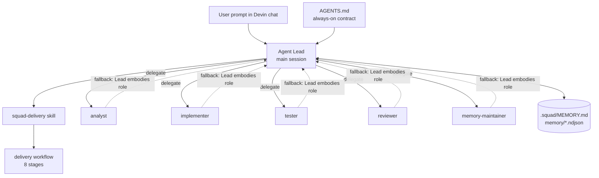
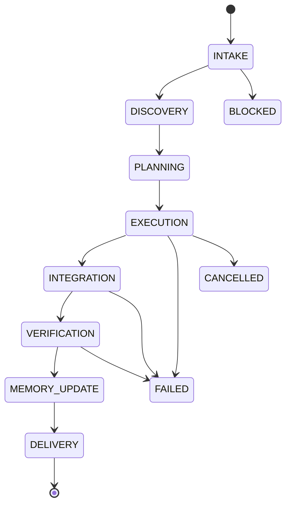

# XQ Squad

Repository-native Devin subagent squad. No hosted service. No database. Devin chat is the interface.

## Layout

```text
AGENTS.md                          # Always-on Lead instructions, managed section
.devin/
  agents/                          # Native Devin subagent profiles
  skills/squad-delivery/SKILL.md   # On-demand delivery skill
.squad/
  README.md                        # This file
  squad.json                       # Component catalog and ownership
  install-state.json               # Generated by installer
  MEMORY.md                        # Consumer-owned canonical memory summary
  agents/lead.md                   # Lead role contract
  agents/                           # Specialist role contracts
  workflows/                        # Portable delivery procedures
  schemas/                          # JSON schemas
  scripts/                          # Distributed helper scripts
  knowledge/                        # Consumer-owned repository knowledge
  memory/                           # Consumer-owned structured memory
```

## How to use

1. Install a pinned release: `install.sh --target . --version v1.1.0` (or `curl -LsSf <release>/install.sh | sh -s -- --target . --version v1.1.0`).
2. Open Devin chat on this repository and describe the task in plain language — no commands or special syntax needed. The installed `AGENTS.md` makes Devin the Agent Lead automatically.
3. The Lead reads this README, follows `agents/lead.md`, and invokes the `squad-delivery` skill when useful.
4. Specialist profiles in `.devin/agents/` are delegated to when Devin supports custom subagents; otherwise the Lead performs each role sequentially.
5. Every delivery reports what changed, which checks ran, review findings, and memory status (`UPDATED`, `UNCHANGED`, or `BLOCKED`).
6. The Lead never commits, pushes, or opens a PR unless explicitly asked in the session.
7. Upgrade with `update.sh --target . --version vX.Y.Z`. Managed files update safely; `.squad/MEMORY.md`, `.squad/knowledge/`, `.squad/memory/`, and `.devin/*/local-*` are never touched.

## Separate concurrent sessions

Concurrent delivery is opt-in. Ask your Lead to use
`workflows/concurrent-delivery.md`; approve each delivery's base, branch,
worktree path, and exact file/subtree scope before setup. Every delivery uses
`.squad/worktrees/<delivery-id>` on `squad/<delivery-id>`. Your main checkout
stays user-owned. Overlapping scopes block without override.

The optional helpers require Node.js >=20 and Git worktree support on a local
filesystem. The selected base commit must contain compatible installed helpers.
Installing or updating files in a dirty checkout does not put them in that
commit; the squad never commits them without your authorization.

All linked worktrees share claims under the Git common directory's
`squad/run/`. Approved setup appends a local `/.squad/worktrees/` exclude entry,
not a tracked `.gitignore` change. Inspect claims without mutation:

```bash
node .squad/scripts/delivery-session.mjs status
```

Provide JSON on stdin for commands; empty input is allowed for `status`.
`status` does not expose owner tokens. A locked/corrupt registry is indeterminate,
not evidence that the repository is free. Serial execution never bypasses
claims; use an isolated concurrent delivery or wait when another session owns
work.

Heartbeats never expire claims. Resume/release require your explicit approval
and confirmation that the previous owner session and all its commands stopped.
Release preserves branches, worktrees, dirty edits, and untracked files;
cleanup is separate. Failed setup can retain a blocking claim and partial
artifacts for inspected recovery.

Delivery memory goes to the claimed
`.squad/memory/deliveries/<delivery-id>.ndjson`; shared memory reconciliation
is not automatic. Worktrees do not isolate ports, databases, or external
services, and claims do not police non-squad tools. Scripted fixture tests are
not proof of actual two-session Devin compatibility.

## How it works

Squad components inside the consumer repository:



Delivery lifecycle. Any stage may end the run with `FAILED`, `CANCELLED`,
or `BLOCKED`:



## Customization

- Add consumer-owned knowledge under `.squad/knowledge/`.
- Add lessons and events under `.squad/memory/` as NDJSON.
- Add local rules under `.devin/rules/local-*.md`.
- Do not edit managed files between markers unless you intend to override upgrades.

## Managed section in `AGENTS.md`

The installer inserts a marked section into root `AGENTS.md`. Upgrades replace only the content between:

```text
<!-- XQ_SQUAD_MANAGED_START version:vX.Y.Z -->
...
<!-- XQ_SQUAD_MANAGED_END -->
```

Text outside these markers is preserved.
