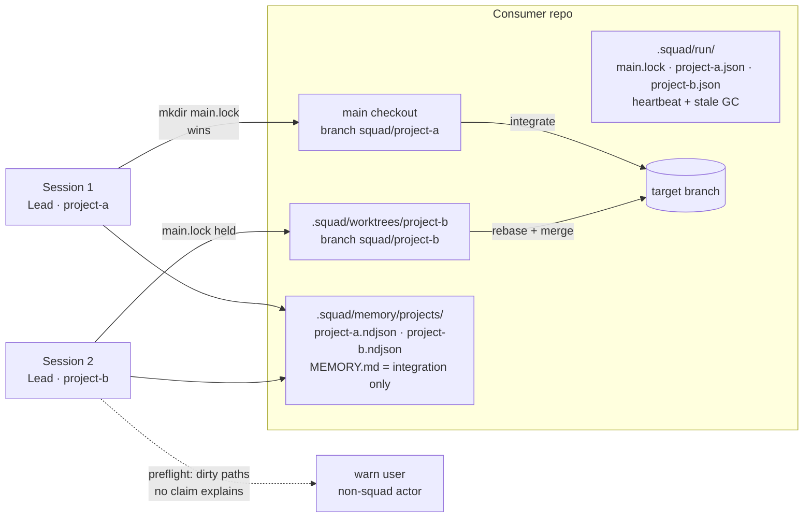

# Concurrent Squad Deliveries — Worktree Isolation

## Problem Statement

How might we let multiple squad projects run in parallel in the same
consumer repository without file, memory, or semantic collisions?

## Recommended Direction

Asymmetric isolation. The first claimant works in the main checkout on
branch `squad/<project>`. Every additional project gets a `git worktree`
at `.squad/worktrees/<project>` on branch `squad/<project>`. There is no
mid-flight migration of a project already running in the main checkout —
migrating dirty state would sweep the consumer's own uncommitted edits
into a squad branch.

Claims are atomic directory/file creation under a gitignored
`.squad/run/` namespace:

- `main.lock` — decides who owns the main checkout (`mkdir`, atomic).
- `<project>.json` — per-project claim: branch, worktree path, heartbeat
  mtime, planned path globs.

Git supplies the real enforcement: each worktree has its own index and
HEAD, and a branch can only be checked out in one worktree at a time.
The squad protocol supplies the rest.

Memory appends are partitioned per project
(`.squad/memory/projects/<project>.ndjson`) so merges stay clean.
`MEMORY.md` is written only during the integration step on the main
checkout, which serializes it by construction.

Preflight warns on dirty paths that no live claim explains (a non-squad
actor editing the tree). Detection only — same-tree edits by non-squad
actors cannot be prevented.

## Prior Art: Hub

The `hub` workspace (`scripts/hub-supervisor.mjs`) already implements
most of this design; it is the proof the mechanism works:

- `worktrees/<repo>/<task>/` per task, existence required before a
  supervise run starts.
- `acquireLock` — `O_EXCL` lock file with PID liveness and stale
  reclaim. Squad ports this as `mkdir`/`noclobber` plus heartbeat mtime
  (agent sessions have no reliable PID).
- `writeScope` per assignment plus a `scopesOverlap` prefix check that
  blocks dispatch of overlapping concurrent work. Squad ports this as
  claim-time path-glob comparison.
- `queue.ndjson` guarded by a `mkdir` `.lock` spinlock — the same
  pattern serializes squad memory writes.
- Worker results validated so `changedPaths` must stay inside
  `writeScope`. Squad ports this as a verification step diffing changed
  paths against the claimed scope.

Key differences: hub worktrees check out other repositories inside the
hub workspace, while squad worktrees live inside the consumer
repository itself (`.gitignore` handling required). Hub serializes all
state through one locked supervisor step; squad has no coordinator, so
claims carry the whole coordination load.

## Key Assumptions to Validate

- [ ] Devin agents keep all writes under the worktree path — test with
      two scripted concurrent sessions on the fixture repository.
- [ ] Consumer build/test tooling tolerates non-root worktree paths
      (relative path assumptions, per-worktree dependency installs).
- [ ] Heartbeat TTL reliably distinguishes crashed claims from
      long-running sessions.

## MVP Scope

- `.squad/run/` gitignored runtime namespace: `main.lock` plus
  `<project>.json` claims (atomic `mkdir`, heartbeat, stale GC).
- Branch `squad/<project>` per project; worktree provisioning for
  non-main claimants.
- Installer-managed `.gitignore` block covering `.squad/run/` and
  `.squad/worktrees/`.
- Memory partition `.squad/memory/projects/<project>.ndjson`;
  `MEMORY.md` writable at integration only.
- New `workflows/concurrent-delivery.md`; updates to `delivery.md`,
  `lead.md`, and `parallel-execution.md` covering intake → claim →
  main-or-worktree → work → integrate → release claim + remove worktree.
- Verification step comparing `git diff --name-only` against claimed
  scope; out-of-scope paths reported `BLOCKED`.
- Shell test: two scripted concurrent deliveries touching the same file.

## Not Doing (and Why)

- Migrating an in-flight project into a worktree — sweeps consumer
  uncommitted edits; the asymmetric rule avoids it entirely.
- OS-level locks or a daemon — no hook into agent sessions exists.
- Blocking non-squad edits — warn only; prevention is impossible in a
  shared tree.
- Merge queue / integration steward — git merge conflicts are already
  the integration mechanism.
- Semantic-overlap inference — claims record planned path globs for
  warnings, but no attempt to detect deeper design conflicts.

## Open Questions

- Heartbeat TTL length — too short kills slow legitimate sessions, too
  long leaves stale claims blocking the main checkout.
- Should claiming a scope that overlaps a live claim block, warn, or
  queue? MVP: warn and let the user decide.
